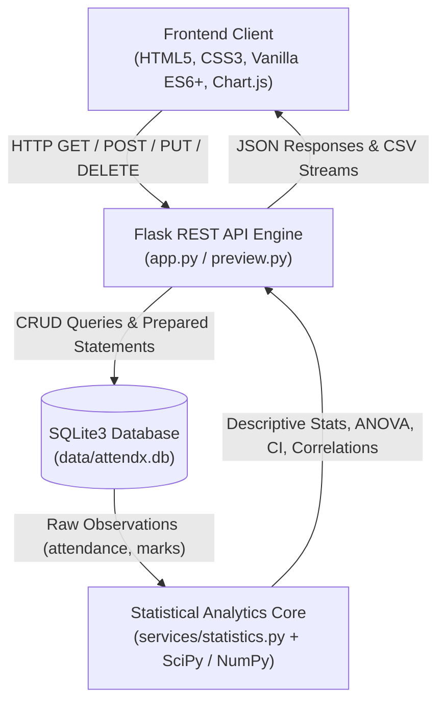

# AttendX — Student Attendance vs Academic Performance Analysis System

[](https://www.python.org/)
[](https://flask.palletsprojects.com/)
[](https://www.sqlite.org/)
[](https://scipy.org/)
[](LICENSE)
[]()

AttendX is a full-stack, research-grade academic analytics platform designed to evaluate and visualize the empirical relationship between classroom attendance percentages and final examination marks. It integrates interactive data exploration, rigorous inferential hypothesis testing via SciPy, and robust data persistence.

---

## Table of Contents
1. [Research Overview & Problem Statement](#research-overview--problem-statement)
2. [Scientific Disclaimer: Association vs. Causation](#scientific-disclaimer-association-vs-causation)
3. [Key Features](#key-features)
4. [System Architecture](#system-architecture)
5. [Directory Structure](#directory-structure)
6. [Technology Stack](#technology-stack)
7. [Database Schema & Integrity](#database-schema--integrity)
8. [Statistical Methodologies & Mathematical Formulation](#statistical-methodologies--mathematical-formulation)
   - [Pearson Product-Moment Correlation ($r$)](#1-pearson-product-moment-correlation-r)
   - [Fisher's $z$-Transformation for 95% Confidence Intervals](#2-fishers-z-transformation-for-95-confidence-intervals)
   - [Spearman's Rank Correlation ($\rho$)](#3-spearmans-rank-correlation-rho)
   - [Levene's Test for Homogeneity of Variance](#4-levenes-test-for-homogeneity-of-variance)
   - [One-Way ANOVA & Welch's ANOVA](#5-one-way-anova--welchs-anova)
   - [Post-Hoc Pairwise Comparisons (Tukey HSD & Games-Howell)](#6-post-hoc-pairwise-comparisons)
9. [CSV Dataset Specifications](#csv-dataset-specifications)
10. [Installation & Setup](#installation--setup)
11. [Running the Application](#running-the-application)
12. [Automated Verification & Testing](#automated-verification--testing)
13. [Limitations & Future Enhancements](#limitations--future-enhancements)

---

## Research Overview & Problem Statement

In contemporary higher education, institutional policy often mandates strict student attendance thresholds under the premise that consistent classroom engagement directly drives academic competence. However, empirical educational research requires rigorous statistical validation rather than unexamined assumptions.

AttendX formalizes this investigation through two distinct research questions:

1. **Research Question 1 (Continuous Association):**  
   *Is there a statistically significant linear or monotonic relationship between student attendance percentage and course examination marks?*  
   - **$H_0$ (Null):** $\rho = 0$ (No population association between attendance and marks).  
   - **$H_1$ (Alternative):** $\rho \neq 0$ (A non-zero association exists).

2. **Research Question 2 (Discrete Tier Variance):**  
   *Do students categorized into discrete attendance tiers (Low: $< 60\%$, Medium: $60\text{--}79.9\%$, High: $\ge 80\%$) exhibit statistically significant differences in academic performance?*  
   - **$H_0$ (Null):** $\mu_{\text{Low}} = \mu_{\text{Medium}} = \mu_{\text{High}}$ (Population mean marks are identical across tiers).  
   - **$H_1$ (Alternative):** At least one attendance tier exhibits a statistically distinct mean examination mark.

---

## Scientific Disclaimer: Association vs. Causation

> [!IMPORTANT]
> **Correlation Does Not Imply Causation.**  
> While statistical analysis may reveal high correlation coefficients ($r$) or significant ANOVA $F$-values, **AttendX does not claim that class attendance directly causes higher examination marks**.

Academic performance is a multivariable outcome governed by confounding factors and omitted variables, including:
- **Prior Academic Aptitude & Background Knowledge:** Students with higher pre-existing mastery may score well regardless of attendance, or conversely attend more lectures out of subject enthusiasm.
- **Outside Study Time & Effort:** Independent study, tutoring, and assignment completion strongly influence performance independent of lecture presence.
- **Socioeconomic & Environmental Constraints:** Work schedules, family obligations, and commute times may suppress attendance without reflecting innate cognitive ability.
- **Instructional Quality & Pedagogical Alignment:** Lecture effectiveness and curriculum delivery affect the utility of attendance for students.

Consequently, statistical outputs generated by AttendX should be interpreted as **empirical associations** intended to guide academic advising, early interventions, and pedagogical reflection.

---

## Key Features

- **Interactive Dynamic Dashboard:** Real-time KPI stat cards, attendance tier distribution charts, and scatter plots with linear regression trendlines powered by Chart.js.
- **Student Record Management (CRUD):** Live search, filtering by attendance tier, multi-column sorting, and paginated records with safe modal dialogs.
- **Granular Dataset Ingestion Engine:** Upload CSV files with strict validation, detailed error reporting per rejected row, duplicate roll-number deduplication, and non-destructive partial imports.
- **Automated Inferential Statistics Pipeline:** Automatically checks parametric assumptions, runs Levene's test for variance homogeneity, and dynamically routes between standard One-Way ANOVA (Tukey HSD) or Welch's ANOVA (Games-Howell).
- **Academic Export & Reports:** Instant live CSV dataset streaming from SQLite, along with a print-optimized CSS stylesheet (`@media print`) for clean browser PDF export.
- **Dual-Origin & Robust Architecture:** Seamlessly operates in either a single unified Flask application or a decoupled local development environment with native CORS preflight support.

---

## System Architecture



---

## Directory Structure

```text
AttendX/
├── .agents/                    # Custom project plugins & rules
├── api/                        # API route blueprints & controller endpoints
├── backups/                    # Verified database state backups
├── config.py                   # Central application configuration & thresholds
├── data/
│   ├── attendx.db              # Active SQLite database (persistent storage)
│   └── sample_dataset_synthetic.csv # Synthetic 20-row test dataset
├── database.py                 # SQLite connection manager, schema, and queries
├── preview.py                  # Self-contained zero-config entrypoint
├── pytest.ini                  # Pytest configuration settings
├── README.md                   # Complete academic documentation & guide
├── requirements.txt            # Python dependencies
├── services/
│   └── statistics.py           # SciPy inferential statistical computation engine
├── static/
│   ├── css/
│   │   ├── components.css      # UI components, badges, modals, spinners
│   │   ├── layout.css          # Responsive layout, grid, and navigation drawer
│   │   └── variables.css       # Design tokens, typography, and color palette
│   ├── js/
│   │   ├── api.js              # REST client with dynamic BASE_URL detection
│   │   ├── app.js              # State coordinator, student CRUD, CSV upload
│   │   ├── charts.js           # Chart.js initialization & data sync
│   │   └── ui.js               # Tab navigation, modals, toasts, XSS escaping
│   └── vendor/
│       └── chart.umd.min.js    # Local offline-ready Chart.js bundle
├── templates/
│   └── index.html              # Unified Single Page Application interface
└── tests/
    ├── test_backend.py         # Flask API, routing, validation, & security tests
    ├── test_integration.py     # End-to-end integration & upload tests
    └── test_statistics.py      # Statistical algorithms & edge-case unit tests
```

---

## Technology Stack

| Layer | Component | Description |
| :--- | :--- | :--- |
| **Frontend UI** | Semantic HTML5 & CSS3 | Accessible semantic markup, responsive CSS Grid / Flexbox, CSS Custom Properties |
| **Frontend Logic** | Vanilla JavaScript (ES6+) | Dependency-free modular state coordination, DOM management, and XSS sanitization |
| **Data Visualization** | Chart.js (v4.4.1) | Local offline UMD bundle for interactive scatter plots and bar distributions |
| **Backend Framework** | Python 3 / Flask | Lightweight WSGI REST API handling routing, JSON serialization, and CSV streaming |
| **Database Engine** | SQLite3 | ACID-compliant embedded database using parameterized SQL queries and schema CHECK constraints |
| **Scientific Computing** | SciPy (`scipy.stats`) & NumPy | Industrial-strength scientific libraries for correlation, ANOVA, and hypothesis testing |
| **Test Automation** | Pytest | Comprehensive 48-test suite covering units, edge cases, integration, security, and startup persistence |

---

## Database Schema & Integrity

The persistence layer uses SQLite3 located at `data/attendx.db`. All transactions use strictly parameterized queries (`?`) to prevent SQL injection vulnerabilities.

### Tables

#### 1. `students` Table
Stores individual student academic records and performance metrics.

```sql
CREATE TABLE IF NOT EXISTS students (
    id INTEGER PRIMARY KEY AUTOINCREMENT,
    roll_number TEXT UNIQUE NOT NULL,
    name TEXT NOT NULL,
    attendance_percentage REAL NOT NULL CHECK(attendance_percentage >= 0.0 AND attendance_percentage <= 100.0),
    marks REAL NOT NULL CHECK(marks >= 0.0 AND marks <= 100.0),
    created_at TIMESTAMP DEFAULT CURRENT_TIMESTAMP,
    updated_at TIMESTAMP DEFAULT CURRENT_TIMESTAMP
);

CREATE INDEX IF NOT EXISTS idx_students_roll ON students(roll_number);
CREATE INDEX IF NOT EXISTS idx_students_attendance ON students(attendance_percentage);
```

#### 2. `upload_logs` Table
Audit log tracking every bulk CSV upload transaction.

```sql
CREATE TABLE IF NOT EXISTS upload_logs (
    id INTEGER PRIMARY KEY AUTOINCREMENT,
    filename TEXT NOT NULL,
    total_rows INTEGER NOT NULL,
    valid_rows INTEGER NOT NULL,
    rejected_rows INTEGER NOT NULL,
    created_at TIMESTAMP DEFAULT CURRENT_TIMESTAMP
);
```

---

## Statistical Methodologies & Mathematical Formulation

All inferential calculations are computed dynamically in `services/statistics.py` directly from the active database records.

### 1. Pearson Product-Moment Correlation ($r$)
Measures the strength and direction of the linear relationship between continuous attendance ($X$) and examination marks ($Y$):

$$r = \frac{\sum_{i=1}^{n} (x_i - \bar{x})(y_i - \bar{y})}{\sqrt{\sum_{i=1}^{n} (x_i - \bar{x})^2 \sum_{i=1}^{n} (y_i - \bar{y})^2}}$$

- **Degrees of Freedom:** $df = n - 2$
- **Assumptions:** Continuous variables, paired observations, bivariate normality, linear relationship, absence of extreme outliers.
- **Two-Tailed $p$-value:** Derived from the $t$-distribution where $t = r \sqrt{\frac{n-2}{1 - r^2}}$.

### 2. Fisher's $z$-Transformation for 95% Confidence Intervals
Because the sampling distribution of $r$ is skewed when $|r|$ is large, the Fisher $z$-transformation is used:

$$z = \frac{1}{2} \ln \left( \frac{1 + r}{1 - r} \right) = \operatorname{artanh}(r)$$

The standard error of $z$ is:

$$\operatorname{SE}_z = \frac{1}{\sqrt{n - 3}}$$

The $95\%$ confidence interval for $z$ is $z \pm 1.95996 \cdot \operatorname{SE}_z$, which is transformed back to correlation units:

$$r_{\text{lower/upper}} = \tanh(z_{\text{lower/upper}})$$

### 3. Spearman's Rank Correlation ($\rho$)
Non-parametric metric assessing monotonic relationships based on ranked values $R(x)$ and $R(y)$:

$$\rho = 1 - \frac{6 \sum_{i=1}^{n} d_i^2}{n(n^2 - 1)}$$

where $d_i = R(x_i) - R(y_i)$.
- **Assumptions:** Paired observations, ordinal or continuous measurements. Does not assume normality or strictly linear relationships.

### 4. Levene's Test for Homogeneity of Variance
Evaluates the assumption of equal variances across the three attendance groups:

$$W = \frac{N - k}{k - 1} \frac{\sum_{i=1}^{k} N_i (\bar{Z}_{i\cdot} - \bar{Z}_{\cdot\cdot})^2}{\sum_{i=1}^{k} \sum_{j=1}^{N_i} (Z_{ij} - \bar{Z}_{i\cdot})^2}$$

where $Z_{ij} = |Y_{ij} - \tilde{Y}_{i\cdot}|$ and $\tilde{Y}_{i\cdot}$ is the group median (Brown-Forsythe variation).
- If $p \ge 0.05$: Equal variances assumed $\rightarrow$ standard One-Way ANOVA.
- If $p < 0.05$: Heteroscedasticity detected $\rightarrow$ Welch's ANOVA.

### 5. One-Way ANOVA & Welch's ANOVA
Compares mean examination marks across attendance groups ($k = 3$):

#### Standard ANOVA:
$$F = \frac{\text{MS}_{\text{between}}}{\text{MS}_{\text{within}}} = \frac{\frac{\text{SS}_{\text{between}}}{k - 1}}{\frac{\text{SS}_{\text{within}}}{N - k}}$$

#### Welch's ANOVA (used when variances are unequal):
Applies weights $w_i = \frac{n_i}{s_i^2}$ to each group to prevent Type I error inflation without requiring homoscedasticity.

### 6. Post-Hoc Pairwise Comparisons
- **Tukey's Honestly Significant Difference (HSD):** Applied following standard ANOVA. Controls the family-wise error rate across all pairwise comparisons using the Studentized Range distribution.
- **Games-Howell Post-Hoc Test:** Applied following Welch's ANOVA. Robust against unequal group sizes and variances.

---

## CSV Dataset Specifications

AttendX accepts standard `.csv` files for batch ingestion.

### Header Requirements
The first line of the uploaded file must contain the following case-sensitive column headers:

```csv
roll_number,name,attendance_percentage,marks
```

### Field Definitions & Validation Rules

| Column | Data Type | Permitted Range / Format | Mandatory | Description |
| :--- | :--- | :--- | :--- | :--- |
| `roll_number` | Text | Non-empty alphanumeric string | Yes | Unique student identifier. |
| `name` | Text | Non-empty string | Yes | Student's full name. |
| `attendance_percentage`| Float | `0.0` to `100.0` | Yes | Recorded class attendance. |
| `marks` | Float | `0.0` to `100.0` | Yes | Final examination marks. |

### Error Quarantine & Rejection Handling
- Rows with invalid or out-of-range numerical values are quarantined and reported with exact line numbers.
- Roll numbers that already exist in the database are rejected to prevent unintentional overwrites.
- Valid rows within the same file are committed safely (partial atomic ingestion).

### Sample Synthetic Dataset
A pre-formatted 20-row sample dataset is available at [`data/sample_dataset_synthetic.csv`](file:///home/utkarsh/Projects/AttendX/data/sample_dataset_synthetic.csv).

> [!NOTE]
> All student names and numbers in `sample_dataset_synthetic.csv` are **fictitious demo entries** created strictly for pipeline verification.

```csv
roll_number,name,attendance_percentage,marks
DEMO-2026-001,Aarav Patel,92.5,88.0
DEMO-2026-002,Bhavna Sharma,84.0,81.5
DEMO-2026-003,Chirag Verma,67.5,62.0
DEMO-2026-004,Divya Nair,95.0,91.0
DEMO-2026-005,Eshan Mehta,54.0,49.0
```

---

## Installation & Setup

### Prerequisites
- Linux, macOS, or Windows (WSL recommended)
- Python 3.10 or higher
- Git

### 1. Clone the Repository
```bash
git clone https://github.com/utkarsh/AttendX.git
cd AttendX
```

### 2. Set Up Virtual Environment
```bash
python3 -m venv venv
source venv/bin/activate
```

### 3. Install Dependencies
```bash
pip install -r requirements.txt
```

---

## Running the Application

### Option A: Unified Full-Stack Server (Recommended)
Runs the unified backend, serving the static frontend and REST API simultaneously:

```bash
python3 preview.py 5000
```
*Alternatively:*
```bash
./venv/bin/python app.py
```

Open your web browser and navigate to:
```text
http://127.0.0.1:5000
```

### Option B: Decoupled Development Mode
Run the Flask API backend and frontend static server on separate ports:

1. **Terminal 1 (Flask API Backend on Port 5000):**
   ```bash
   ./venv/bin/python app.py
   ```
2. **Terminal 2 (Frontend Static Server on Port 5500):**
   ```bash
   python3 -m http.server 5500
   ```

Open your browser at:
```text
http://127.0.0.1:5500
```
*The frontend automatically detects port 5500 and routes all API calls to `http://127.0.0.1:5000` with native CORS preflight support.*

---

## Automated Verification & Testing

The test suite consists of 48 comprehensive tests spanning API routes, database transactions, statistical formulas, edge cases, startup persistence, and end-to-end integration flows.

### Running All Tests
```bash
./venv/bin/pytest tests/ -v
```

### Verification Matrix Summary

| Test Module | Tests | Focus Area | Status |
| :--- | :---: | :--- | :---: |
| [`tests/test_backend.py`](file:///home/utkarsh/Projects/AttendX/tests/test_backend.py) | 30 | REST endpoints, CRUD lifecycle, CSV upload validation, SQL injection resistance, XSS sanitization, CORS headers, empty database startup, delete-all persistence | **PASSED** |
| [`tests/test_statistics.py`](file:///home/utkarsh/Projects/AttendX/tests/test_statistics.py) | 12 | Pearson $r$, Spearman $\rho$, Welch's ANOVA, Games-Howell, IQR outliers, zero variance, negative correlations | **PASSED** |
| [`tests/test_integration.py`](file:///home/utkarsh/Projects/AttendX/tests/test_integration.py) | 6 | Frontend asset delivery, multi-step student lifecycle, CSV import/export pipeline, search/filter/pagination | **PASSED** |
| **Total** | **48** | **Complete System Verification** | **100% PASS** |

---

## Limitations & Future Enhancements

- **Univariate Cross-Sectional Analysis:** The current release focuses on cross-sectional analysis between attendance and a single exam mark metric. Longitudinal tracking across multiple terms is planned for future iterations.
- **Multivariate OLS Regression:** Incorporating additional explanatory variables (e.g., homework submissions, continuous assessment, lab attendance) via Ordinary Least Squares multiple regression.
- **Direct PDF Generation:** While browser print styles (`Ctrl+P` / `Cmd+P`) are built-in, future releases will incorporate headless server-side PDF generation for automated administrative reporting.
- **Authentication & RBAC:** Role-Based Access Control (instructor vs. student views) for multi-tenant institutional deployments.

---

## License
AttendX is distributed under the [MIT License](LICENSE). Academic attribution and citation are appreciated when used in institutional research.
